# Old EM: reported issues, checked

The IT solution manager and the testers reported issues they believe exist in Old EM, without being sure. Each one was checked on **Old EM UAT** (https://www.uat.ted.synergy.yomaland360.com) by running the test cases that target it, on **12–13 Nov 2026**.

Use this page to confirm with the people who reported them: *"Is this the issue you meant?"* For each issue, the steps to reproduce it by hand are in a collapsed box; open it only when you need it.

| | Count | Issues |
|---|---|---|
| **Group 1 · Confirmed** (Old EM really has the problem) | 7 | Payment concurrency · UO duplicate invoices · SOA next-month balance · Initial balance edit · Wallet payment after credit note · Invoice calculation · Missing Created By / Approved By |
| **Group 2 · Not reproduced** (Old EM behaved correctly in our tests) | 5 | Back-dated transactions · Wallet payment after wallet transfer · Wallet transfer after RV · Account Statement with cash transfer first in the day · Data left after rejecting a credit note |
| **Not checked** | 1 | Database data transformation |

Notes on how the tests were run:

- Every test creates its own apartment, account and documents (names start with `QE`), so other testers' data cannot change the results.
- Old EM UAT has one test account. Where an issue needs **two users**, the tests used **two sessions of the same admin**, and the same admin made and approved documents.
- Full test output and all screenshots: [old-em-issues.md](old-em-issues.md). Test cases: [projects/em/docs/test-cases/](../../em/docs/test-cases/README.md).

**Pattern worth telling the developers:** three of the confirmed issues (1.3, 1.4, 1.5) are correct in the current period and wrong only in the **next period's opening balance** (next day or next month). Old EM seems to store an opening balance and not recalculate it after some changes. They may share one cause.

---

## Group 1 · Confirmed

### 1.1 Two payments of the same invoice at the same moment are not handled safely

| | |
|---|---|
| **Reported** | Tester: "Balance Issue (… Concurrency)" |
| **What happens** | When two users pay the same invoice at the same moment, Old EM can accept **both** payments: the invoice is paid twice, overpaid, or its due amount is overwritten. Other times one payment fails with **"Internal Server Error"** instead of a clear message. It depends on timing. |
| **Fails at** | The second user's **Confirm** on Make Payment. Expected: refused with "This invoice has already been paid in full" (or "Please refresh and try again"). |
| **Test cases** | CONC-001 ❌ · CONC-003 ❌ · CONC-004 ❌ · OB-WAL-012 ❌ · OB-ACS-010 ❌ (money safe, wrong message) |

What the tests saw:

| Case | Situation | Result |
|---|---|---|
| CONC-001 | Both users pay a 1,000 Ks invoice in full | Earlier runs, 3 of 3 races: **both accepted**: SOA shows payments 1,000 + 1,000, Balance Due −1,000, account +2,000. Final run: the second user got "Internal Server Error". |
| CONC-003 | Users pay 400 and 500 of a 1,000 Ks invoice | Earlier runs: both accepted, but the invoice due and AR show **500 instead of 100**. Final run: one got "Internal Server Error". |
| CONC-004 | Users pay 500 and 600 of a 1,000 Ks invoice | Earlier runs, 3 of 3: **both accepted**: 1,100 paid, Balance Due −100. Final run: the second got "Internal Server Error". |
| OB-WAL-012 | Two wallet refunds of the full wallet balance | Both refund **drafts** are created (case: the second should be refused). Approval still blocks the second one, so the wallet never goes below 0. |
| OB-ACS-010 | Two cash outflows of the full account balance | Money safe: only one is approved. The second approval sometimes gets "Internal Server Error" instead of "Insufficient Balance". |

Paying one after the other is handled correctly: the second payment is refused.

Steps to check by hand (CONC-001)

You need two browser windows logged in at the same time: two users, or the same user in Chrome and in a private window.

1. Create an apartment, then create and approve an invoice of **1,000 Ks** for it (Invoices / Debit Note › Create Invoice › Approve).
2. In **both** windows: Apartments › the apartment › **Invoices** tab › **Make Payment**.
3. In both windows fill the form the same way: Currency MMK, a location, Payment Method Cash, Received In = a cash account, tick the invoice to pay **1,000** in full.
4. Click **Confirm** in both windows **at the same moment** (one person with two mice, or two people counting down).
5. Check the apartment **S.O.A** tab, the invoice status and the account balance.

- **Expected:** one payment of 1,000; the other window shows "This invoice has already been paid in full. No further payments are required."; Balance Due 0; the account +1,000.
- **Bug:** two payments of 1,000, Balance Due −1,000, account +2,000; or one window shows "Internal Server Error".
- It may need several tries: the two clicks must reach the server within a fraction of a second.

Screenshots

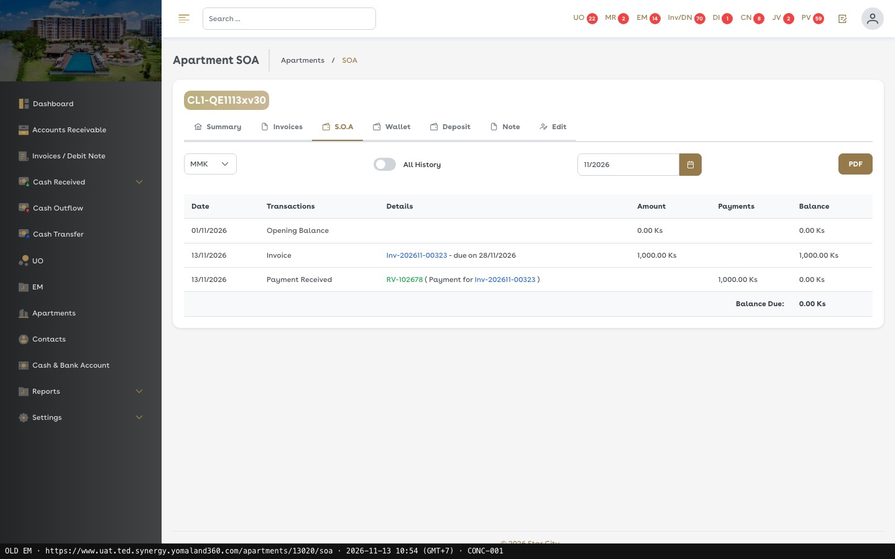
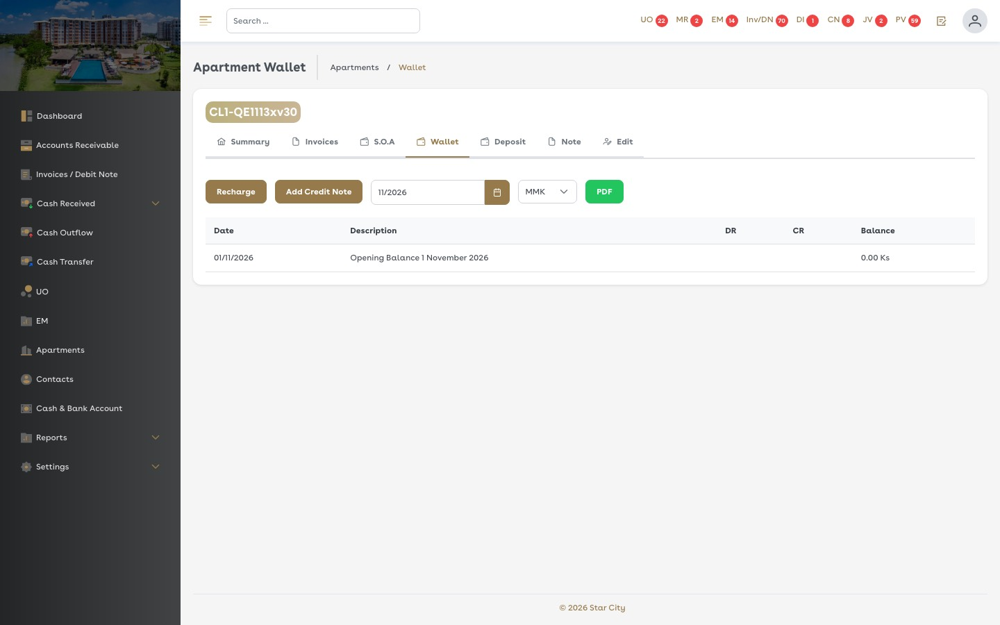
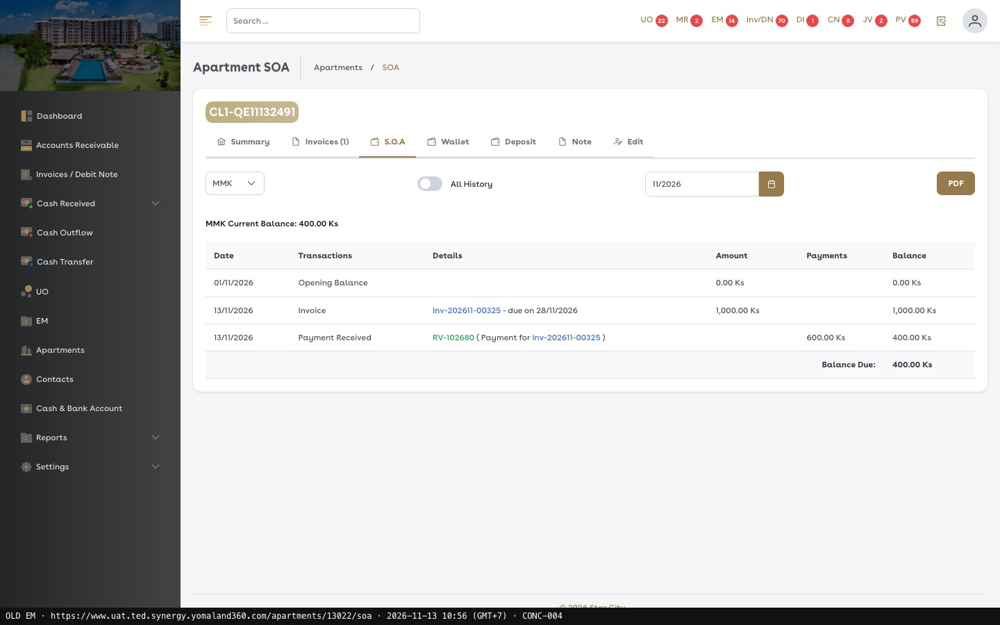
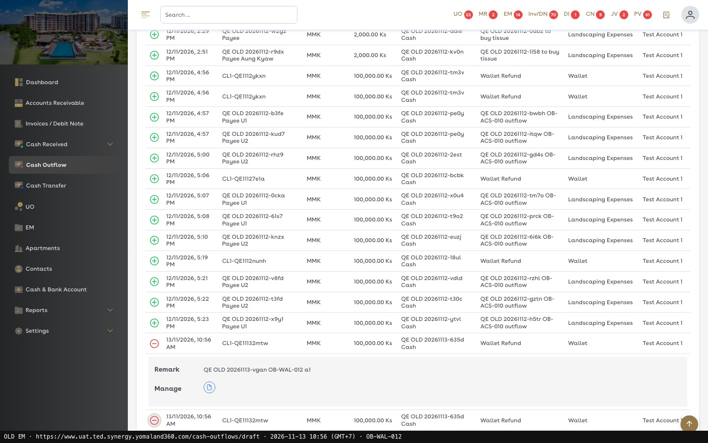

---

### 1.2 One UO import file with two rows for the same apartment creates two invoices

| | |
|---|---|
| **Reported** | IT solution manager: "UO invoice duplication when bulk upload"; tester: "UO Bulk Issue" |
| **What happens** | If the import file has **two rows for the same apartment in the same month**, Old EM imports both ("2 UO Entry imported.") with no error. The apartment gets **two UO entries and two invoices**. The second row is also calculated from the old reading (e.g. "18 − 10 = 8" next to "15 − 10 = 5"), so **the same usage is billed twice**. |
| **Fails at** | The upload step: the second row should be rejected. |
| **Test cases** | UOI-013 ❌ (all 4 variants, every run) · UOI-029 ✅ · UOI-028 ✅ · UO-008 ✅ |

Other ways of getting duplicates were checked and are handled:

- Uploading the **same file again** is rejected ("There is already a record with 'Reading Date' in the same month…").
- Two uploads **at the same moment** are usually blocked, but with an **"Internal Server Error"** message. Once, during a manual try, both went through and the apartment got two invoices (Inv-202611-00134 and -00135).
- **Bulk Approve** of UO drafts creates exactly one invoice per draft.

Steps to check by hand (UOI-013)

1. Create an apartment and give it an approved UO reading for **last month** (UO › New, reading 10 for each meter, then approve). Old EM refuses an import for an apartment with no earlier reading.
2. UO › **Import** › download the template.
3. Fill **two rows for the same apartment** with reading dates in **this month**, for example row 1 = reading 15 dated the 1st, row 2 = reading 18 dated today.
4. Upload the file.
5. Check the import message, the UO list, and the apartment's **Invoices** tab and **S.O.A**.

- **Expected:** row 1 imported; row 2 rejected (same month as the first); one new invoice.
- **Bug:** "2 UO Entry imported."; two UO entries and two new invoices; the SOA shows both.

Screenshots

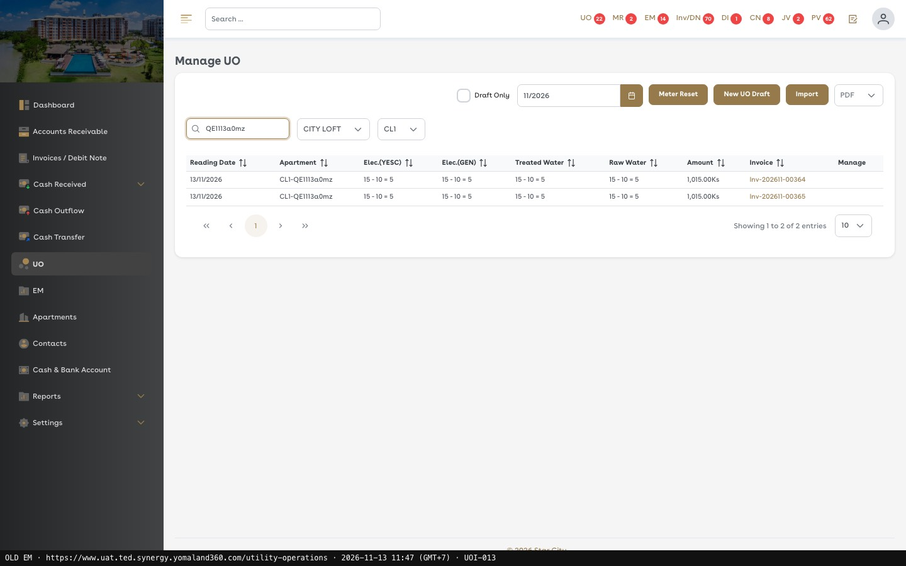
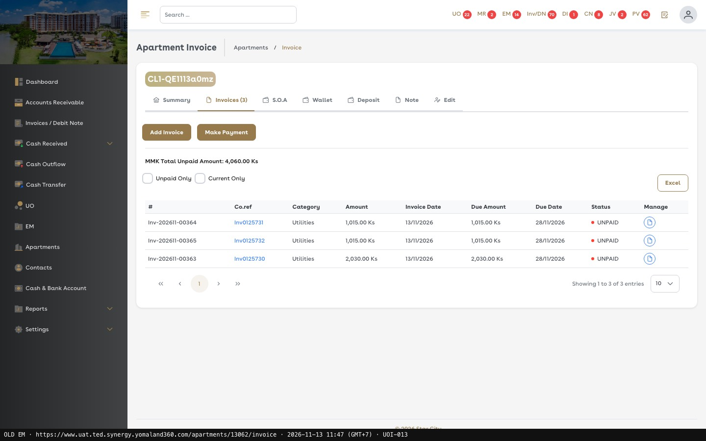
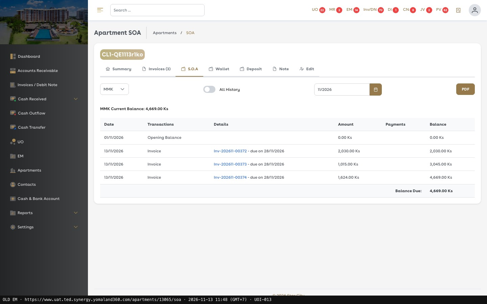

---

### 1.3 SOA: next month's opening balance leaves out a bulk-approved UO invoice

| | |
|---|---|
| **Reported** | IT solution manager: "SOA periodic balances are wrong"; tester: "Opening & Closing Balance Mismatch Issue" |
| **What happens** | After a UO invoice made by **Bulk Approve** is paid from the wallet, the SOA is right for the current month, but **next month opens at 882.00 instead of 2,100.00**. Next month counts the payment (−1,218) but not the invoice (+1,218). |
| **Fails at** | Apartment › S.O.A › **next month**, Opening Balance. |
| **Test cases** | OB-SOA-017 [UO bulk approve → Wallet Payment] ❌ · 7 other OB-SOA-017 pairs ✅ · OB-SOA-010 ✅ |

The other sequences checked were all correct: Invoice → UO import, UO import → Make Payment, UO import → Wallet Payment, manual UO → UO import, Make Payment → Wallet Payment, Wallet Payment → Invoice, Wallet Payment → UO import, Wallet Payment of one or several invoices.

Steps to check by hand (OB-SOA-017, UO bulk approve → Wallet Payment)

1. Create an apartment. Create and approve an invoice dated **last month** for 2,000 Ks, so this month opens with a balance (2,100 in our run, including earlier charges).
2. Recharge the apartment's wallet (Wallet tab › Recharge) with enough to pay a UO invoice, e.g. 5,000 Ks.
3. Create a **UO draft** for the apartment (UO › New).
4. Approve it with **Bulk Approve**: UO › draft list › tick the draft › Bulk Approve. Note the invoice amount (1,218 Ks in our run).
5. Make Payment for that UO invoice with Payment Method **Wallet**.
6. Open the apartment **S.O.A** for **this month**: note the closing balance (2,100).
7. Switch the month to **next month**: read the Opening Balance.

- **Expected:** next month's Opening Balance = this month's closing balance (2,100.00).
- **Bug:** 882.00 (= 2,100 − 1,218): the payment is counted, the invoice is not.

Screenshots

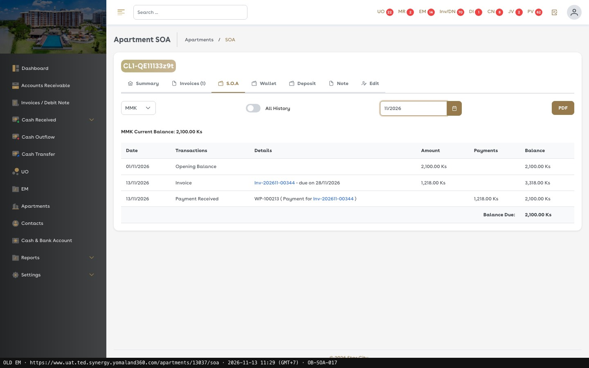
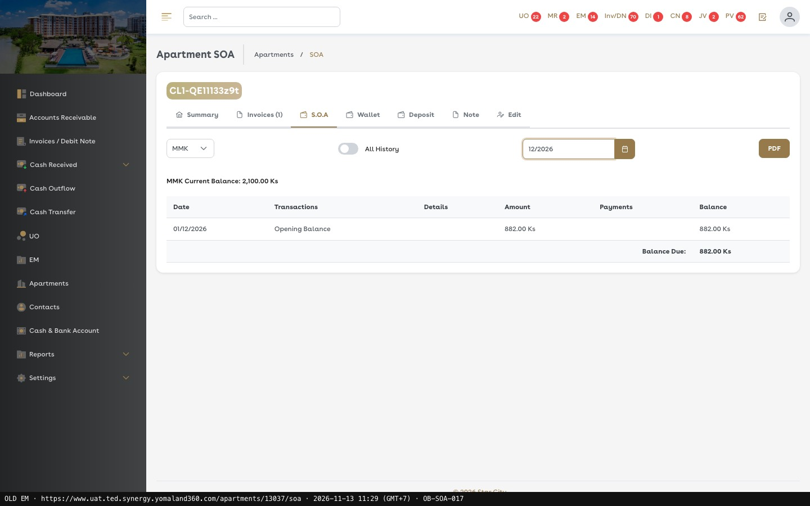

---

### 1.4 Editing an account's initial balance is not carried into the next day

| | |
|---|---|
| **Reported** | Tester: "Balance Issue (Initial Balance Edit…)" |
| **What happens** | After editing the initial balance of an account that **already has transactions**, the account list, the dashboard and **today's** Account Statement show the new balance (51,100). But **tomorrow's** statement still opens at the **old** balance (11,100). |
| **Fails at** | Reports › Account Statement › the account › **tomorrow's date**, Opening Balance. |
| **Test cases** | CBA-010 ❌ · CBA-009 ✅ (editing before any transaction is fine) |

Steps to check by hand (CBA-010)

1. Cash & Bank Account › **New**: Cash, MMK, initial balance **10,000**.
2. Record a receipt into it, e.g. Cash Received › Funding Received of **1,100**, so the closing balance is 11,100.
3. Cash & Bank Account › edit the account › change the initial balance to **50,000** › save. The list now shows the closing balance 51,100.
4. Reports › **Account Statement** › the account › **today**: closing balance 51,100.
5. Open the statement for **tomorrow**. The date picker blocks future days; change the dates in the address bar: `/reports/account-statements/<account id>/<tomorrow>/<tomorrow>`.

- **Expected:** tomorrow's Opening Balance = today's closing balance = 51,100.00.
- **Bug:** 11,100.00, the balance before the edit.

Screenshots

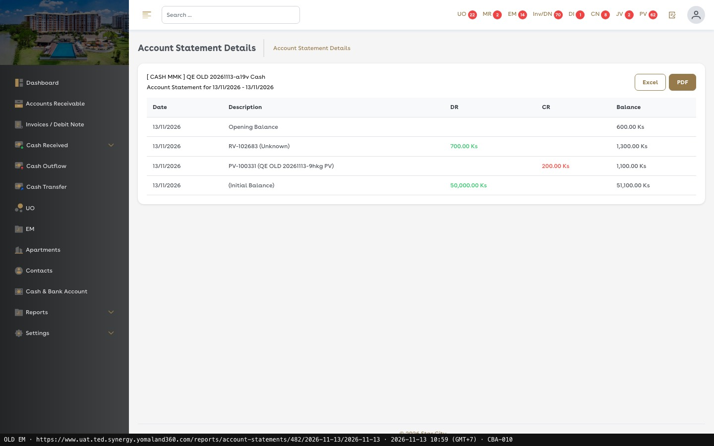
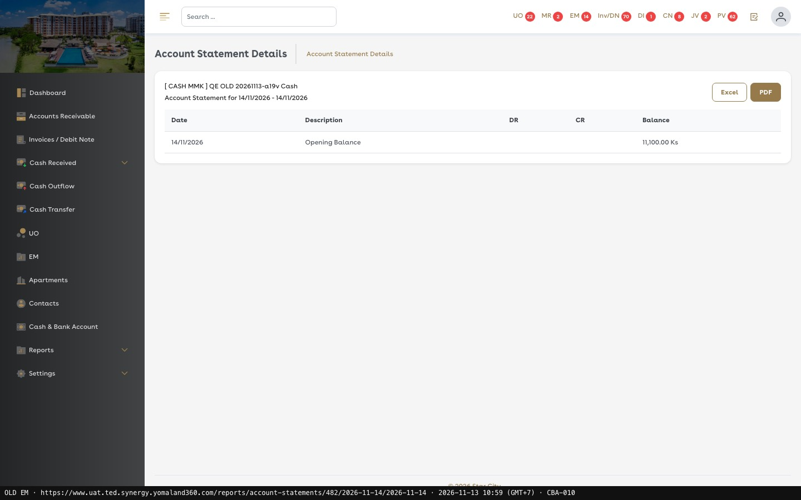

---

### 1.5 Wallet: next month's opening balance ignores a wallet payment made after a credit note

| | |
|---|---|
| **Reported** | Tester, Wallet Issue 1: "An issue occurs when a 'Wallet Payment' follows a 'Credit Note'" (status: can reproduce) |
| **What happens** | Credit note **+50,000**, then a wallet payment **−10,500**: this month is right (closes at 39,500), but **next month opens at 50,000** instead of 39,500. The payment is lost. |
| **Fails at** | Apartment › Wallet › **next month**, Opening Balance. |
| **Test cases** | OB-WAL-011 [Credit Note → Wallet Payment] ❌ |

Steps to check by hand (OB-WAL-011, CN → WP)

1. Create an apartment (wallet balance 0).
2. Apartment › **Wallet** › add a **Credit Note** of 50,000 Ks; approve it (top bar **CN** › draft › Approve). The wallet shows 50,000.
3. Create and approve an invoice of **10,500 Ks** for the apartment.
4. Make Payment for it with Payment Method **Wallet**.
5. Wallet tab, **this month**: closing balance and Current Balance 39,500.
6. Switch the Wallet tab to **next month**: read the Opening Balance.

- **Expected:** 39,500.00.
- **Bug:** 50,000.00.

Screenshots

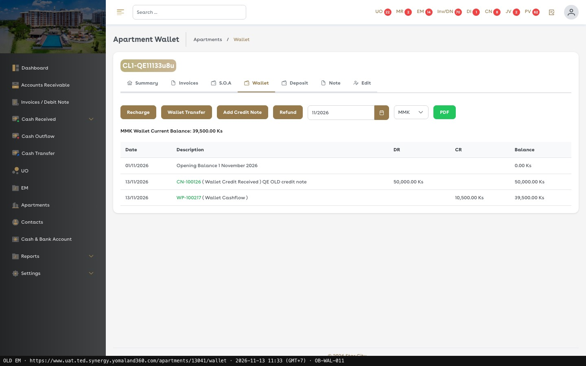

---

### 1.6 Invoice form loses the typed Gross Price or discount

| | |
|---|---|
| **Reported** | Tester: "Invoice Calculation (Decimal/Rounding issue)" |
| **What happens** | Not a rounding error: rounding is correct. The invoice form asks the server to recalculate the totals after each change, and the server's answers **overwrite the fields the user typed**. When answers arrive out of order, **Gross Price is wiped** ("The Gross Price field is required" under a field that shows a value, or Total 0) or **the discount is dropped**. Some invoices are refused; some are saved **without the discount** (3,090.00 instead of 2,781.00). |
| **Fails at** | Create Invoice, after typing Gross Price / Discount, and on **Create**. |
| **Test cases** | INV-038 ❌ (all 4 variants, every run) · INV-001 ❌ (3 to 5 of 10 runs) |

What the tests saw:

- In the final run, the fields changed **in every sample within 6 seconds**, the first change 16 ms after typing. On screen: Disc. Price 1,500.000 instead of 1,350, Total 3,000.000 instead of 2,700, Tax 90 instead of 81.
- Saved without the discount: 3,090.00 instead of 2,781.00; 1,029.99 instead of 926.99; 103.10 instead of 103.05.
- When a draft did save correctly, the draft, approved invoice, AR, SOA, contact, Invoices report and PDF all agreed.

Steps to check by hand (INV-038, base row)

1. Invoices / Debit Note › **Create Invoice**; select an apartment, an income category, currency MMK.
2. Item: Tax Type "3% Tax", Unit **2**, Gross Price **1,500**, Discount **10 %**. Type at a normal speed, then click outside.
3. **Watch the line for a few seconds** without touching anything. Expected: Disc. Price 1,350, Total 2,700, Tax 81, Grand Total 2,781.00.
4. Click **Create**; open the draft in the Inv/DN draft list and compare its total with the form.
5. Repeat 5 times.

- **Bug:** Gross Price empties by itself, or "The Gross Price field is required" shows under a filled field, or Total goes to 0, or the discount disappears; or the draft is saved as 3,090.00.

Screenshots

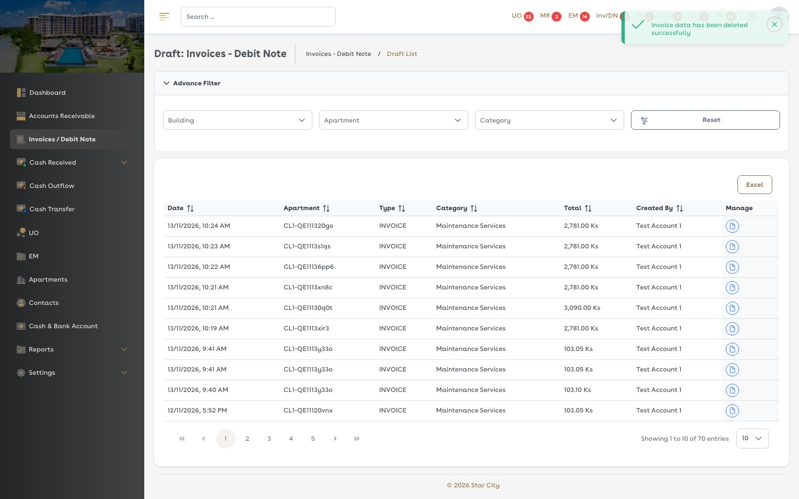

---

### 1.7 "Created By" / "Approved By" missing from some lists

| | |
|---|---|
| **Reported** | Tester: "Missing Audit Trails: 'Approved By' and 'Created By' fields are missing in some transactions" |
| **What happens** | The names are always on the **voucher / detail page** and in the **reports**, but some **lists** do not show them. |
| **Fails at** | Opening the document's list after approval. |
| **Test cases** | RPT-036 ❌ for 7 of 12 document types · ✅ for 5 |

| Document | List checked | Missing |
|---|---|---|
| Invoice, Debit Note, UO invoice, EM debit note | Invoices / Debit Note list | **Approved By** (no column) |
| Cash Transfer (JV) | Cash Transfer › Recent Transfers | **Approved By** (no column) |
| Credit Note (CN) | Apartment › Wallet tab | **Created By and Approved By** |
| Wallet Transfer (WT) | Apartment › Wallet tab | **Created By** |
| Make Payment RV, Unknown Received RV, Cash Outflow PV, Wallet Refund PV, Deposit Withdraw PV | Their lists | Nothing missing ✅ |

Steps to check by hand (RPT-036)

For each document type in the table:

1. Create the document and approve it if it needs approval.
2. Open its **list** (see the table) and look for Created By / Approved By on its row.
3. Open its detail page and its **Voucher** / PDF; then the matching report (Invoices, Transactions, Cash Received, Cash Outflow, Credit Note).

- **Expected:** Created By (and Approved By when approval applies) everywhere.
- **Bug:** missing in the lists marked above; present on vouchers and reports.
- Ask the reporter which screen they meant: if it is a list, this is it. If they meant a voucher or a report, we did not find it missing.

Screenshots

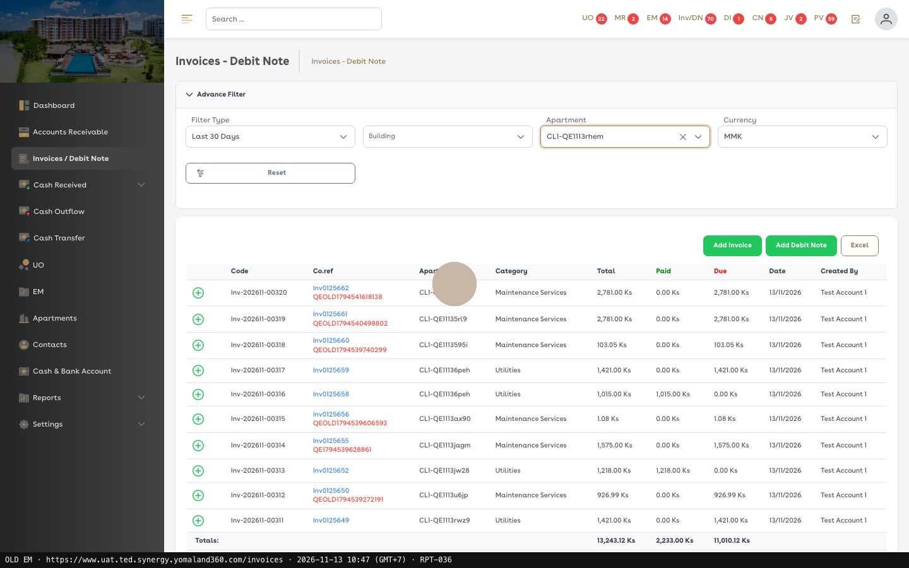
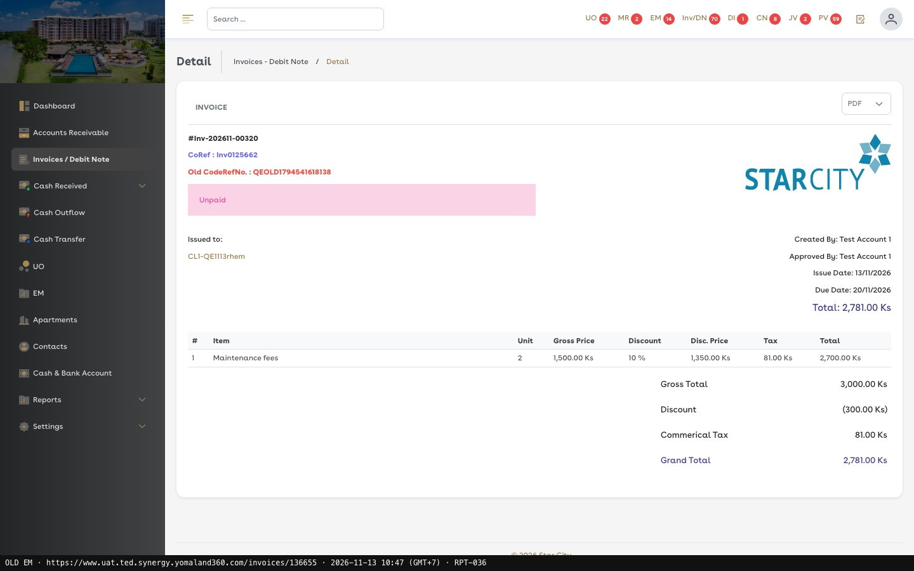
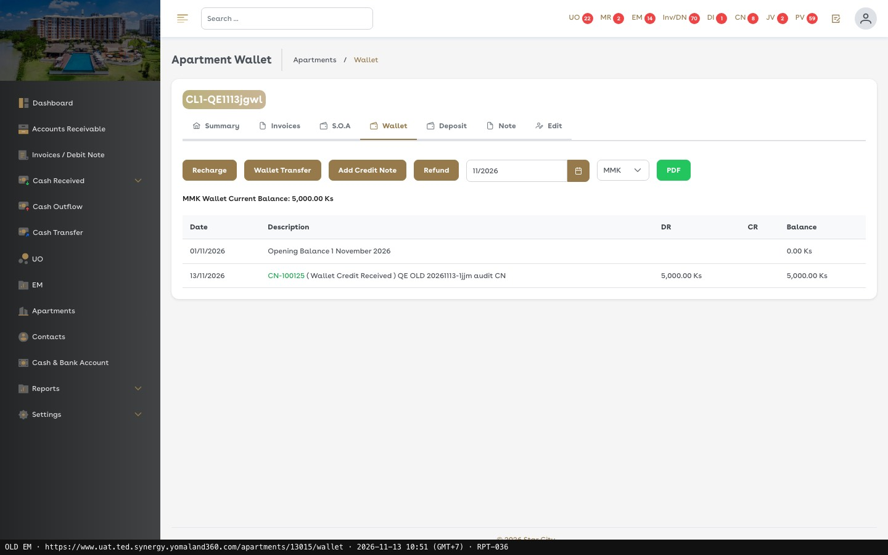

---

## Group 2 · Not reproduced

These passed in our tests. Old EM behaved as the test cases expect. Ask the reporter for the exact steps or data. The issue may need conditions we did not create, such as old data or a specific order of actions.

### 2.1 Back-dated transactions keep balances continuous

| | |
|---|---|
| **Reported** | Tester: "Balance Issue (… Backdated Transaction …)" |
| **What we checked** | Back-dated **invoices** in the SOA (1st, middle and last day of last month, 3 categories); back-dated **cash transfers** in the Account Statement (3 days back); back-dated **wallet recharges** (1st, middle, last day of last month, MMK and USD, with and without overflow). Every day / month: Opening Balance = previous Closing Balance. |
| **Why it passes** | All balances were continuous. The back-dated documents were added after documents that already existed, in date order. |
| **Test cases** | OB-SOA-003 ✅ (3) · OB-ACS-006 ✅ (2) · OB-WAL-002 ✅ (4) |
| **Ask the reporter** | Which document type and which screen? Was the back-dated document approved late (e.g. a PV or credit note approved days after its date)? That case was not run here (OB-WAL-004, OB-WAL-006, OB-DEP-004, OB-ACS-004). |

Steps to check by hand (OB-SOA-003)

1. Create an apartment with one invoice dated this month.
2. Create and approve an invoice dated the **1st of last month**, then one on the **15th**, then one on the **last day** of last month.
3. Apartment › S.O.A: check last month (rows in date order, running balance) and this month.

- **Expected and seen:** this month's Opening Balance = last month's closing balance; each row's balance = previous row ± amount.

---

### 2.2 Wallet Payment after a Wallet Transfer

| | |
|---|---|
| **Reported** | Tester, Wallet Issue 2: "An issue occurs when a 'Wallet Payment' follows a 'Wallet Transfer'" (status: cannot reproduce) |
| **What we checked** | Wallet Transfer **in** then Wallet Payment, and Wallet Transfer **out** then Wallet Payment. Both wallets, this month and next month, plus the SOA. |
| **Why it passes** | Every balance, running balance and next month's opening balance was right. |
| **Test cases** | OB-WAL-011 [WT Cash In → WP] ✅ · [WT Cash Out → WP] ✅ |
| **Ask the reporter** | The same pattern was confirmed after a **credit note** (1.5). Was the original report maybe about a credit note, or a transfer between apartments of different owners or currencies? |

Steps to check by hand (OB-WAL-011, WT → WP)

1. Apartment A: recharge the wallet with 50,000. Apartment B: create an invoice of 10,500.
2. Wallet tab of A › **Wallet Transfer** 20,000 to B.
3. Apartment B › Make Payment of the invoice with **Wallet**.
4. Check both wallets this month and **next month** (Opening Balance), and B's S.O.A.

- **Expected and seen:** A 30,000; B 20,000 − 10,500 = 9,500, also as next month's opening.

---

### 2.3 Wallet Transfer after a receipt (RV)

| | |
|---|---|
| **Reported** | Tester, Wallet Issue 3: "An issue occurs when a 'Wallet Transfer' follows an RV" (status: cannot reproduce) |
| **What we checked** | Wallet recharge (RV), then Wallet Transfer in, and then Wallet Transfer out; both wallets this month and next month. |
| **Why it passes** | All balances right. |
| **Test cases** | OB-WAL-011 [RV → WT Cash In] ✅ · [RV → WT Cash Out] ✅ |
| **Ask the reporter** | Was the RV an **Unknown Received** assigned to the wallet, or in another currency? Only a direct wallet recharge was used here. |

Steps to check by hand (OB-WAL-011, RV → WT)

1. Apartment A › Wallet › **Recharge** 50,000 (cash account).
2. Wallet › **Wallet Transfer** 20,000 to apartment B.
3. Check both wallets this month and next month.

- **Expected and seen:** A 30,000, B 20,000; next month opens with the same values.

---

### 2.4 Account Statement when a Cash Transfer is the first transaction of the day

| | |
|---|---|
| **Reported** | Tester, Account Statement: "An error occurs if 'Cash Transfer' is the very first transaction of the day" (status: code fixed, data correction scripts not run yet) |
| **What we checked** | A new account whose **first transaction ever** is a Cash Transfer (JV), in and out; statements from yesterday to tomorrow. |
| **Why it passes** | The statement opens without error and the balances are continuous. This matches "the code has been fixed". |
| **Test cases** | OB-ACS-005 ✅ (2) |
| **Not checked** | **Existing data** created before the fix. The reporter says the data correction scripts have not been run: those accounts may still show the problem. A developer should confirm which accounts/days are affected and that the script has run. |

Steps to check by hand (OB-ACS-005)

1. Create two new cash accounts (one with 10,000, one with 0).
2. Cash Transfer 3,000 from the first to the second; approve the JV (top bar **JV**).
3. Reports › Account Statement › each account › today, yesterday and tomorrow.

- **Expected and seen:** no error; today's opening = yesterday's closing; tomorrow's opening = today's closing.
- To check old data: open the statement of an existing account on a day whose first transaction was a Cash Transfer before the fix.

---

### 2.5 Data left behind when a credit note draft is rejected

| | |
|---|---|
| **Reported** | Tester: "Incomplete Deletion on Rejection: when a credit note draft is rejected, only the Credit Note table row is deleted, not the Cash Transaction row" |
| **What we checked** | Add a credit note (draft), **Remove** it from the CN draft list as approver, then the draft list and counter, wallet balance and transactions, SOA, Credit Note report, and a wallet payment of the full balance afterwards. Also deleting a draft as its creator. |
| **Why it passes** | Nothing of the removed credit note is visible anywhere, and the wallet payment used only the real balance. |
| **Test cases** | WAL-033 ✅ · WAL-017 ✅ |
| **Limit** | The issue is about a **database table**. A leftover row that no screen or balance reads cannot be seen from the UI. **A developer should check the database** (`cash transactions` for the removed CN id). If the row is there but not used anywhere, the issue is real but has no visible effect today. |

Steps to check by hand (WAL-033)

1. Apartment with a wallet balance of 50,000.
2. Wallet › add a **Credit Note** of 10,000 (draft).
3. Top bar **CN** › the draft › **Remove**.
4. Check: CN draft list and counter, Wallet tab (balance 50,000, no CN line), S.O.A, Reports › Credit Note.
5. Pay an invoice of 50,000 with the Wallet method; the wallet must end at 0.00.
6. Developer: query the cash transaction table for the removed credit note.

---

## Not checked

### Database data transformation

| | |
|---|---|
| **Reported** | Tester: "Displaying transformed/formatted data to the user instead of showing raw database data directly" |
| **Why not checked** | The note does not say which screen shows raw data, so no test case could be written. |
| **Ask the reporter** | One example: the screen, the field, what it shows now, and what it should show. Seen in New EM testing: the Account Statement showed raw text in some fields. |
